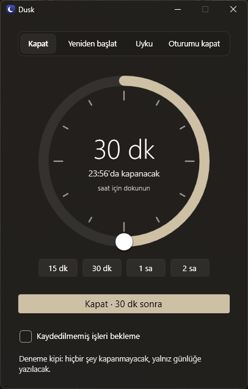

<p align="center">
  
</p>

<h1 align="center">Dusk</h1>

<p align="center">
  A calm, safe shutdown timer for Windows.<br>
  Drag the dial, walk away.
</p>

<p align="center"><a href="README.tr.md">Türkçe</a></p>

---

## Why another shutdown timer?

Most timers just run `shutdown /s /t 3600` and hope for the best. Dusk is built around not surprising you:

- **Nothing is pre-scheduled.** Windows is never told to shut down later. The action happens only when the countdown ends, so closing Dusk always cancels it.
- **Your unsaved work is respected.** By default, Windows waits for apps that have unsaved documents. Forcing them closed is an opt-in checkbox.
- **The warning never steals your keyboard.** One minute before the end, a heads-up appears on top: snooze 10 minutes, cancel, or do it now. It never grabs focus, so keys you type in a game or another app can't trigger it by accident.
- **No surprise after sleep.** If the PC was asleep when the time came, Dusk cancels and tells you instead of shutting down the moment you wake it.
- **It actually fires.** While counting down, the PC is kept from idling into sleep. The screen can still turn off.
- **No admin rights. A single instance. A 350 KB exe.**

## Features

- Shut down, restart, sleep or sign out
- Round dial: one lap is an hour, laps stack up to 12 hours. Also works with the mouse wheel and arrow keys.
- Tap the center to switch between a duration ("1 h 30 min") and a time of day ("23:45")
- Quick picks: 15 min, 30 min, 1 h, 2 h
- Keeps counting in the notification area when you close the window
- Windows 11 Fluent design, follows your light/dark mode and accent color
- Screen-reader friendly: the dial is exposed as a slider
- Event log at `%AppData%\Dusk\dusk.log`, so "why didn't it shut down last night?" always has an answer
- Trial mode: `Dusk.exe --deneme` only logs what would happen

## Install

Download `Dusk.exe` from [Releases](../../releases) and run it. It needs the [.NET 10 Desktop Runtime](https://dotnet.microsoft.com/download/dotnet/10.0).

## Build

```
dotnet test
dotnet publish src/Dusk -c Release -r win-x64 --self-contained false -p:PublishSingleFile=true -o dist
```

## Project layout

| Path | What |
|---|---|
| `src/Dusk.Core` | UI-free logic: the countdown state machine, time texts, settings |
| `src/Dusk` | The WPF app: dial, warning window, tray icon |
| `tests/Dusk.Tests` | Unit tests for the core |
| `tools/make-icon.ps1` | Generates the app icon |

The interface is in Turkish for now.

## License

[MIT](LICENSE)
